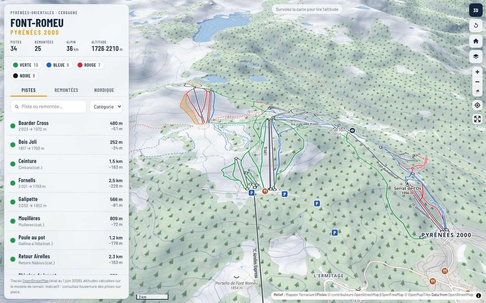
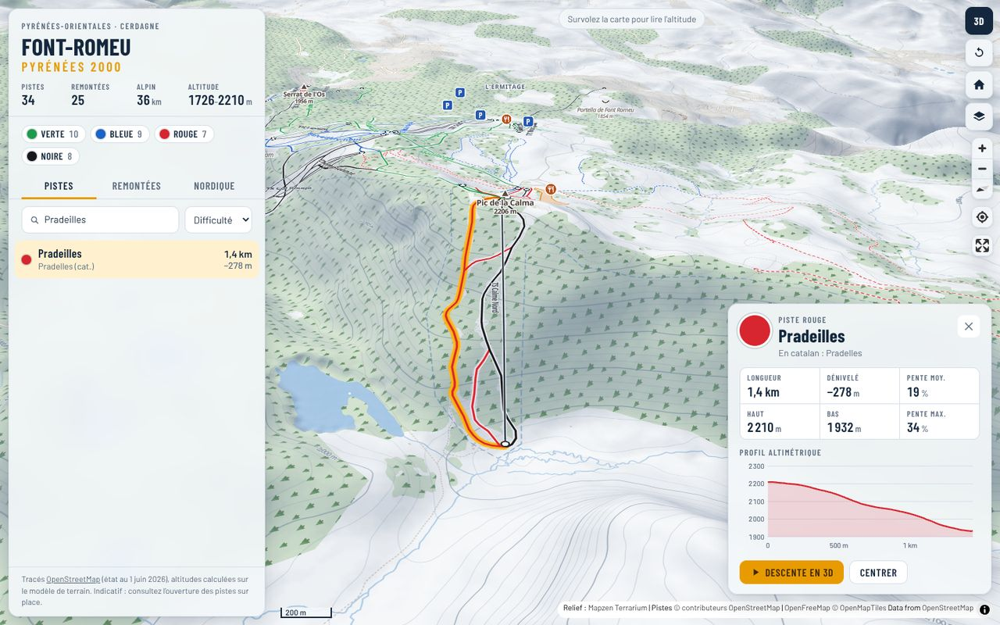

# Font-Romeu 3D

Carte interactive en relief de la station de ski **Font-Romeu Pyrénées 2000** (Pyrénées-Orientales) :
pistes alpines, remontées mécaniques, ski de fond, raquettes, sommets et services, posés sur un
modèle de terrain en 3D.



## Fonctionnalités

- **Relief 3D** du domaine et des sommets alentour (Carlit, Roc d'Aude…), avec exagération réglable,
  ombrage du relief et courbes de niveau cotées.
- **4 fonds de carte** : plan des pistes « hivernal » (forêts en motif de sapins), photo aérienne IGN,
  Plan IGN et OpenTopoMap.
- **34 pistes alpines** aux couleurs officielles (verte, bleue, rouge, noire), avec leur nom catalan
  quand il existe, et **25 remontées** avec leur sigle (TSD, TS, TK, TC, tapis).
- **Ski de fond et raquettes** : boucles nordiques (Panoramique, Martin Fourcade, La Petite Calme…)
  et itinéraires piétons.
- **Fiche détaillée** au clic ou depuis la liste : longueur, dénivelé, altitudes haute et basse,
  pente moyenne et maximale, débit et nombre de places pour les remontées.
- **Profil altimétrique** interactif : survolez la courbe pour suivre le point sur la carte.
- **Descente / montée virtuelle en 3D** : la caméra suit la piste ou la remontée de bout en bout.
- **Tour panoramique** autour du domaine, vue 2D / 3D, géolocalisation, plein écran.
- Altitude et coordonnées sous le curseur, recherche, tri (longueur, dénivelé, altitude, nom),
  filtres par difficulté, lien partageable (la position de la carte est dans l'URL).
- Adapté au téléphone (liste en volet coulissant) et au mode sombre.



## Ouvrir la carte

Aucune compilation n'est nécessaire : il s'agit d'une page statique.

- **Directement** : ouvrez `index.html` dans un navigateur récent (connexion Internet requise pour
  les fonds de carte et le relief).
- **Avec un petit serveur local** (recommandé pour la géolocalisation) :

  ```bash
  python3 -m http.server 8000
  # puis http://localhost:8000
  ```

- **En ligne avec GitHub Pages** : *Settings → Pages → Deploy from a branch*, choisir la branche
  et le dossier racine `/`. La carte sera servie à l'adresse `https://<utilisateur>.github.io/<dépôt>/`.

## Mettre à jour les données

Les pistes et remontées viennent d'OpenStreetMap ; les altitudes, longueurs et pentes sont
calculées sur le modèle numérique de terrain. Pour régénérer `data/font-romeu.js` :

```bash
pip install pillow numpy
python3 scripts/build_data.py                 # télécharge OSM + tuiles d'altitude
python3 scripts/build_data.py --cache .cache  # réutilise les téléchargements
```

Le script interroge l'API Overpass (avec des serveurs de secours), regroupe les tronçons d'une même
piste, oriente les pistes vers l'aval et les remontées vers l'amont, puis calcule les statistiques
et les profils.

## Organisation

```
index.html            page principale
css/style.css         mise en forme (thèmes clair et sombre, mobile)
js/app.js             carte MapLibre, calques, interactions, profils, animations
data/font-romeu.js    données générées (GeoJSON + statistiques)
scripts/build_data.py génération des données
docs/                 captures d'écran
```

## Sources et licences

| Élément | Source | Licence |
| --- | --- | --- |
| Pistes, remontées, sommets, services | © contributeurs [OpenStreetMap](https://www.openstreetmap.org/copyright) | ODbL |
| Relief (MNT) | [Mapzen Terrarium](https://registry.opendata.aws/terrain-tiles/) sur AWS Open Data | attributions multiples |
| Plan des pistes (fond vectoriel) | [OpenFreeMap](https://openfreemap.org) / OpenMapTiles | ODbL / CC-BY |
| Photo aérienne et Plan IGN | [IGN – Géoplateforme](https://geoservices.ign.fr) | Licence Ouverte Etalab 2.0 |
| OpenTopoMap | [opentopomap.org](https://opentopomap.org) | CC-BY-SA |
| Moteur cartographique | [MapLibre GL JS](https://maplibre.org) 5.24, [maplibre-contour](https://github.com/onthegomap/maplibre-contour) | BSD-3 |

Les tracés OpenStreetMap peuvent différer du plan officiel de la station : la carte est indicative.
Consultez l'ouverture des pistes et l'état de la neige auprès de la station avant de partir.
